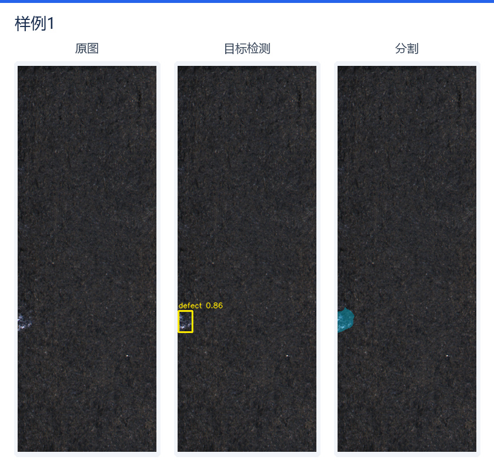
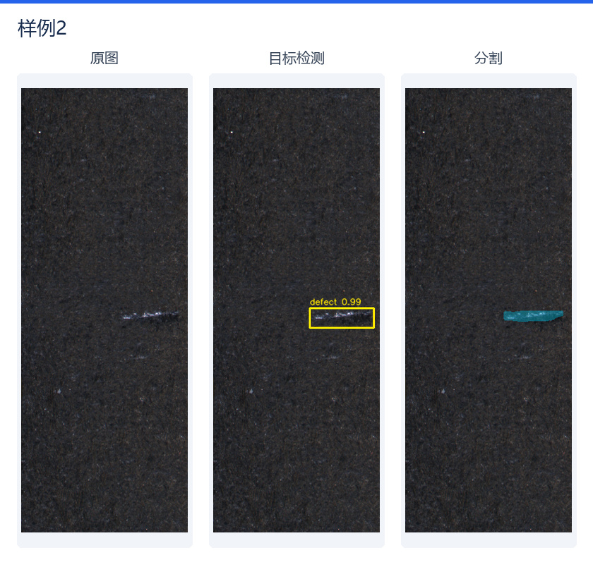
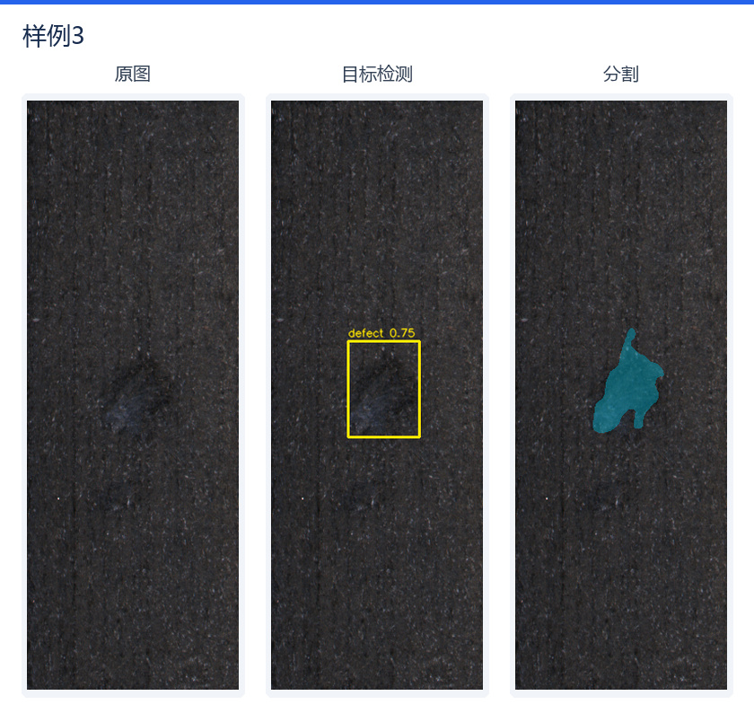

# 工业表面缺陷检测与分割系统

## 功能

- **缺陷检测**：定位表面缺陷，输出检测框和置信度。
- **像素级分割**：提取缺陷区域，输出原图尺寸的二值掩膜。
- **结果可视化**：保存检测结果、分割叠加图及检测与分割的综合结果。
- **批量推理**：支持单图或文件夹输入，可独立选择检测、分割或同时运行。

## 效果展示

以下三组样例均由本项目的 ONNX 模型实际推理生成，依次展示原图、目标检测和分割结果。







## 快速运行

进入本目录，使用 Python 3.11 安装依赖并运行：

```bash
pip install -r requirements.txt
python infer.py --source examples/inputs --output outputs/my_run --mode both
```

默认使用 CPU，推理端仅依赖 **NumPy、OpenCV、ONNX Runtime**。
`--mode` 可选 `detect`、`segment`、`both`。
结果保存至指定目录，每次运行使用新的输出目录。

模型文件位于 `models/`：`detection.onnx`、`segmentation.onnx` 和 `manifest.json`。

## 技术栈

Python · PyTorch · OpenCV · ONNX · ONNX Runtime
