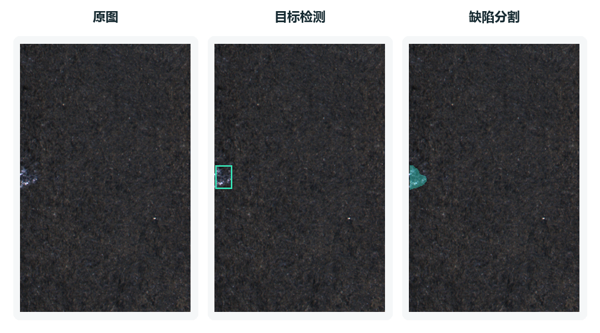
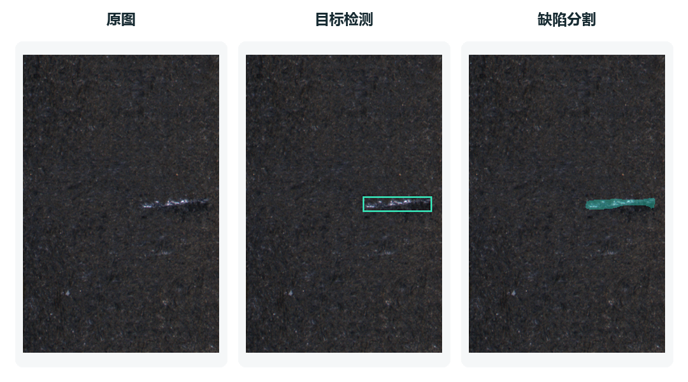
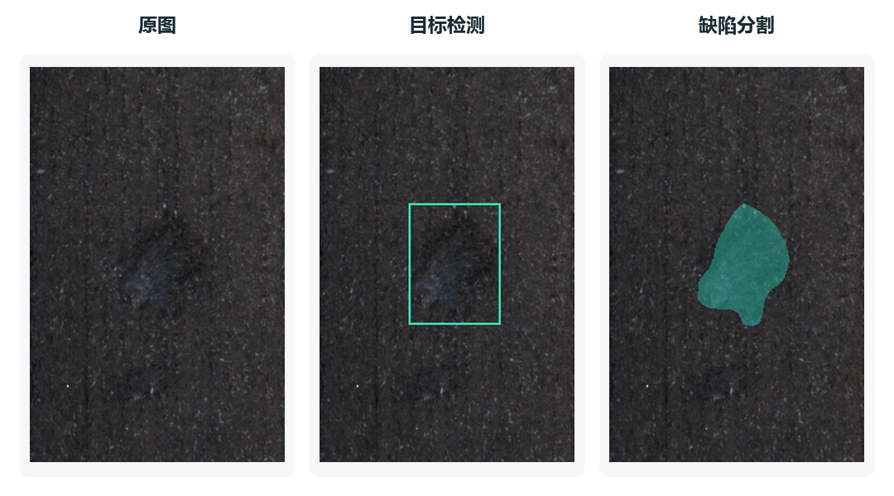
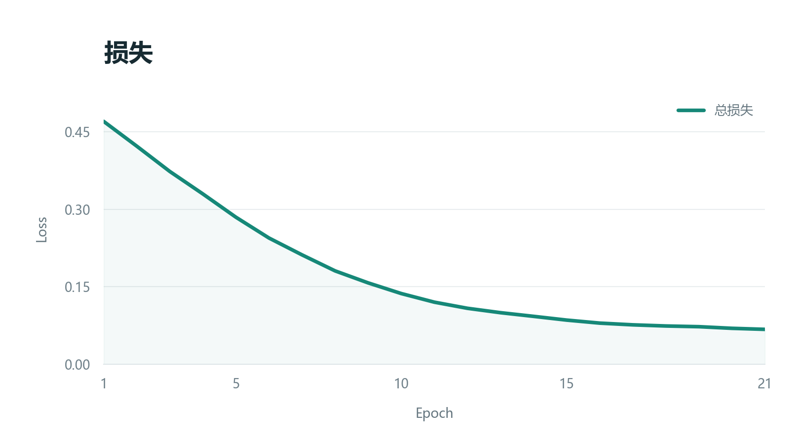
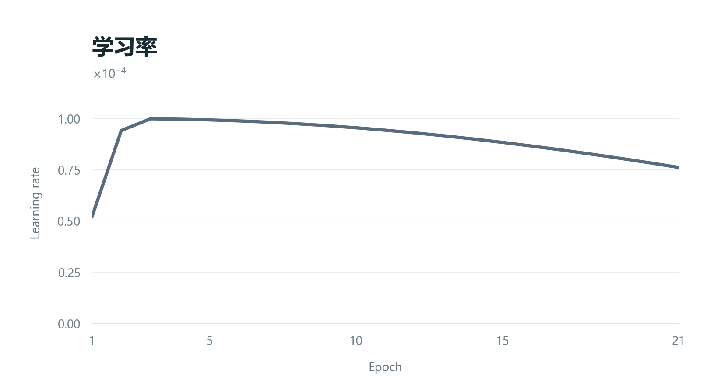

# 工业表面缺陷检测与分割系统

## 功能

- **缺陷检测与分割**：共享主干网络，同时输出缺陷框与像素级掩膜。
- **可视化与批量推理**：支持单张图片或文件夹输入，保存框、掩膜和叠加结果。
- **模型训练与评估**：包含数据处理、联合训练、断点恢复及检测与分割评价。
- **ONNX 部署**：提供独立推理接口和模型导出、一致性检查脚本。

## 效果展示







## 训练过程

<p>
  
  
</p>

## 快速运行

模型使用 Git LFS 管理；通过 Git 克隆时请确保已拉取 LFS 文件。使用 Python 3.11，在项目根目录执行：

```bash
pip install -r requirements.txt
python infer.py --input examples/inputs --output outputs/demo
```

## 工程结构

```text
configs/          M0、M1 训练配置
jointcv/          数据处理、共享主干模型、训练与评估
inference/        独立 ONNX Runtime 推理
scripts/          数据准备、导出、验证和展示生成
tests/            数据、指标与训练控制测试
examples/inputs/  三张样例原图
models/           ONNX 权重与模型接口描述
experiments/m1/   训练参数、日志和评估结果
docs/             展示页面和图片
run.py            训练、评估与 PyTorch 推理入口
infer.py          ONNX 推理入口
```

## 技术栈

Python · PyTorch · TorchVision · OpenCV · ONNX · ONNX Runtime
